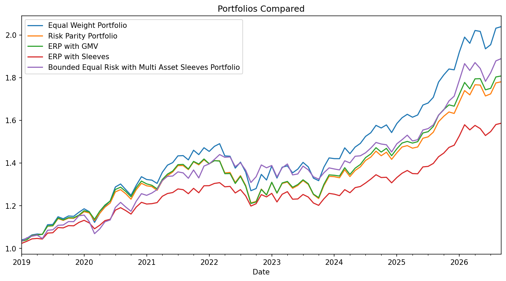
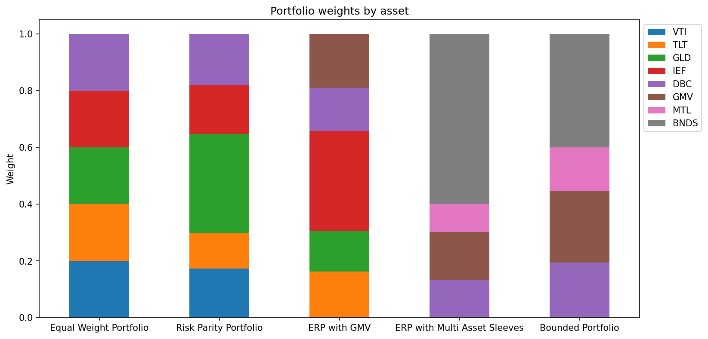
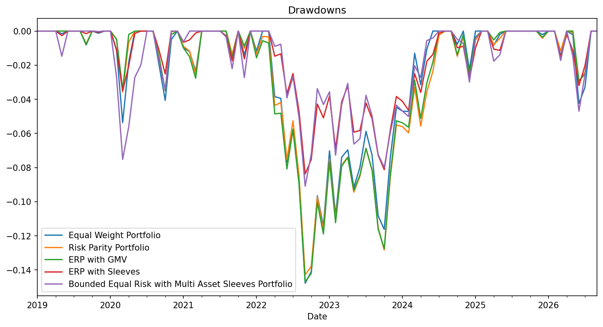

# Modernising the All-Weather Portfolio
## Introduction
* Modernising the All-Weather Portfolio takes the portfolio from Bridgewater Associates and changes it to address modern problems and phenomena's. The new portfolio aims to recreate the portfolio whilst diversifying from these new risks that the contemporary market faces.
## Motivation
* The original five-asset all-weather portfolio looks brittle given inflationary pressure from the Middle East, AI-driven equity concentration, the sovereign bond selloff and elevated gold prices.
- Three of the five assets face headwinds: equities (index concentration in AI), long-dated treasuries (sticky inflation, low G7 growth) and gold (a dollar rebound or a pause in central bank buying could unwind the rally).
- The approach is to reduce sensitivity to these headwinds by diversifying within each asset class and adding new securities.

## Results and Key findings
* Raising the equity weighting improved risk-adjusted returns and drawdown against the original portfolio, and the bond portfolio became less volatile.
* The GMV sleeve helped most, because its low volatility let it become a larger component.
## Results

* Maintaining the drawdown performance of the original portfolios whilst gaining better returns.
|                                                       |   Annualized Return |   Annualized Vol |   Sharpe Ratio |   Sortino Ratio |   Calmar Ratio |   Skewness |   Kurtosis |   Cornish-Fisher VaR (5%) |   Historic CVaR (5%) |   Max Drawdown |   Max DD Duration (mo) |   Hit Rate |   Best Month |   Worst Month |
|:------------------------------------------------------|--------------------:|-----------------:|---------------:|----------------:|---------------:|-----------:|-----------:|--------------------------:|---------------------:|---------------:|-----------------------:|-----------:|-------------:|--------------:|
| Equal Weight Portfolio                                |               0.096 |            0.085 |          0.755 |           1.22  |          0.651 |     -0.412 |      2.842 |                     0.035 |                0.045 |         -0.148 |                     26 |      0.634 |        0.054 |        -0.064 |
| Risk Parity Portfolio                                 |               0.077 |            0.078 |          0.593 |           0.941 |          0.541 |     -0.463 |      2.984 |                     0.033 |                0.043 |         -0.143 |                     31 |      0.645 |        0.049 |        -0.063 |
| ERP with GMV                                          |               0.079 |            0.078 |          0.613 |           0.994 |          0.541 |     -0.433 |      2.933 |                     0.033 |                0.043 |         -0.147 |                     30 |      0.656 |        0.05  |        -0.062 |
| ERP with Sleeves                                      |               0.061 |            0.056 |          0.54  |           0.952 |          0.732 |     -0.368 |      2.619 |                     0.023 |                0.029 |         -0.084 |                     28 |      0.667 |        0.038 |        -0.038 |
| Bounded Equal Risk with Multi Asset Sleeves Portfolio |               0.086 |            0.075 |          0.722 |           1.226 |          0.94  |     -0.406 |      2.713 |                     0.031 |                0.04  |         -0.091 |                     27 |      0.677 |        0.052 |        -0.05  |

## Key decisions
* The uncapped sleeves portfolio put 59% in bonds, leaving it exposed to inflation and US policy shocks and lowering risk-adjusted return.
* A 40% cap was chosen because Sortino and Sharpe gains fade as the cap tightens, and volatility and drawdown rise faster as it approaches a 30% cap and below.

|                |   Annualized Return |   Annualized Vol |   Sortino Ratio |   Max Drawdown |   Hit Rate |
|:---------------|--------------------:|-----------------:|----------------:|---------------:|-----------:|
| NO Constraints |               0.061 |            0.056 |           0.952 |         -0.084 |      0.667 |
| 40%            |               0.086 |            0.075 |           1.226 |         -0.091 |      0.677 |
| 38%            |               0.088 |            0.077 |           1.234 |         -0.092 |      0.677 |
| 30%            |               0.098 |            0.085 |           1.229 |         -0.096 |      0.656 |

* A 38% cap had the best Sortino and hit rate, but picking it would overfit the weights to this data.
* ERC weights were chosen over GMV to avoid concentration in long-dated treasuries and gold when looking at the treasury and metal sleeves.
|                     |   Annualized Return |   Annualized Vol |   Sharpe Ratio |   Sortino Ratio |   Calmar Ratio |   Skewness |   Kurtosis |   Cornish-Fisher VaR (5%) |   Historic CVaR (5%) |   Max Drawdown |   Max DD Duration (mo) |   Hit Rate |   Best Month |   Worst Month |
|:--------------------|--------------------:|-----------------:|---------------:|----------------:|---------------:|-----------:|-----------:|--------------------------:|---------------------:|---------------:|-----------------------:|-----------:|-------------:|--------------:|
| Bond ER Portfolio   |             0.02176 |          0.0466  |       -0.17207 |        -0.35059 |        0.41199 |    0.21739 |    2.54644 |                   0.01928 |              0.02001 |       -0.05283 |                      7 |    0.57778 |      0.03213 |      -0.02052 |
| Bond GMV Portfolio  |             0.01217 |          0.06638 |       -0.26147 |        -0.51794 |        0.14187 |    0.2519  |    2.62225 |                   0.02874 |              0.03025 |       -0.0858  |                     14 |    0.55556 |      0.04606 |      -0.03303 |
| Treasuries          |            -0.01147 |          0.13787 |       -0.2929  |        -0.55793 |       -0.05689 |    0.32765 |    2.99618 |                   0.06118 |              0.06929 |       -0.20162 |                     41 |    0.55556 |      0.09924 |      -0.07951 |
| Metal ER Portfolio  |             0.16153 |          0.22831 |        0.56047 |         0.83791 |        0.53699 |   -0.43523 |    3.08305 |                   0.10022 |              0.12894 |       -0.30081 |                     15 |    0.6     |      0.13591 |      -0.15156 |
| Metal GMV Portfolio |             0.18239 |          0.21547 |        0.68813 |         1.00491 |        0.63009 |   -0.51055 |    3.24544 |                   0.09352 |              0.12126 |       -0.28946 |                     12 |    0.62222 |      0.13225 |      -0.14658 |
| Gold                |             0.26266 |          0.17884 |        1.26616 |         1.86816 |        1.10133 |   -0.34945 |    3.48206 |                   0.06751 |              0.09368 |       -0.23849 |                      7 |    0.64444 |      0.12273 |      -0.11685 |

## Limitations
* Weights aren’t rebalanced using previous covariance matrices, and without rebalancing the weighting scheme becomes less relevant the longer the backtest runs.
* The new instruments only have history from 2016 and 2019.
* The portfolio conceptually was published post the financial crash, for next steps I'd like to capture the risks and drivers of this portfolio and stress test it for left tail events.
* The returns could be affected by the recent equity and gold rally.
* Drawdown duration barely changed across caps (27 to 28 months), so max drawdown is the better measure.

## Next steps
* Extend the backtest further back.
* Estimate ERC and GMV portfolios on the past three years of data, then rebalance with the max-weight logic, possibly letting some positions grow before profit-taking.
* Include rebalancing costs.
* Adapt the portfolio for different rate regimes (falling and rising rates).
* Test a leveraged risk parity version.

